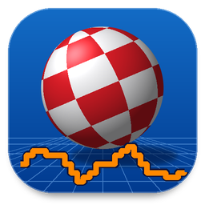

<p align="center"></p>

# WaveToAmiga

**A tool to convert WAV files to common Amiga sound formats – IFF-8SVX, AIFF, IFF-16SV and IFF-MAUD. Qt 6, SoX code, Windows & Linux.**
*(WaveToAmiga – ein Tool zum Konvertieren von WAV-Dateien in gängige Amiga-Soundformate.)*

Author: Michael Bergmann · Website: <https://portfolio.mbergmann-sh.de> · © Michael Bergmann 2026 · [MIT License](LICENSE)

> **GitHub "About":** `Convert WAV files to Amiga sound formats: IFF-8SVX (optional Fibonacci-delta), AIFF, IFF-16SV, IFF-MAUD. Qt 6 / qmake, SoX format handlers, drag & drop, built-in player, Windows + Linux installers.`
> **Topics:** `amiga` `8svx` `aiff` `iff` `maud` `sox` `wav` `audio-converter` `qt6` `qmake` `cpp17`

---

## Formats / Zielformate

| Chooser entry | File | Details |
|---|---|---|
| **IFF-8SVX** | `.8svx` | classic 8-bit signed sample (SoX `8svx.c`); optional **Fibonacci-delta compression** (4 bit/sample, EA IFF 8SVX Appendix C); mono / stereo / quad |
| **AIFF** | `.aiff` | Audio Interchange File Format (SoX `aiff.c`); 8 / 16 / 24 / 32 bit (default: like the source), up to 8 channels |
| **IFF-16SV** | `.16sv` | 16-bit variant of 8SVX (big-endian, channels in separate blocks); mono / stereo / quad |
| **IFF-MAUD** | `.maud` | MacroSystem MAUD (SoX `maud.c`): 16 bit, 8 bit, µ-law or A-law; mono / stereo |

Common options (Preferences): target sample rate (e.g. 8363 / 11025 / 22050 Hz; IFF limits the rate to 65535 Hz – higher
rates are halved automatically), mix to mono, overwrite policy, parallel conversions.

## Features

* **Target-format chooser in the toolbar** – the selected converter is remembered
* Add files via **multi-select dialog** *or* **multi drag & drop** (files and whole folders, recursive)
* Reads PCM 8/16/24/32 bit, IEEE float 32/64 bit, WAVE_FORMAT_EXTENSIBLE, RF64 (24/32-bit sources stay lossless for AIFF)
* High-quality built-in resampler (windowed sinc)
* **Built-in player** for the source files: play, pause, stop, seek, volume
* Parallel conversion, progress per file and overall, cancel at any time; results are written atomically (`.part` → final name)
* The window **size, position and selected converter are saved automatically**
* About dialog with author, website link, MIT license text and third-party notices
* Amiga-themed icon (Boing Ball + 8-bit stepped waveform) for Windows (`.ico`) and Linux (hicolor PNG + SVG)

## Build (qmake6)

Requirements: **Qt 6.5+** (*Widgets*, *Multimedia*), a C++17 compiler, `qmake6`.
Nothing else has to be downloaded – the needed SoX sources are part of this repository (`third_party/sox`).

### Linux
```bash
sudo apt install qmake6 qt6-base-dev qt6-multimedia-dev build-essential   # or use the Qt online installer
scripts/build_linux.sh                 # build + self-test   (binary: build/release/bin/WaveToAmiga)
scripts/build_linux.sh --deploy        # + dist/WaveToAmiga  (program + Qt libs + plugins)
scripts/build_linux.sh --installer     # + Qt Installer Framework setup (needs binarycreator in PATH / IFW_BIN)
```
Manual build / `make install`:
```bash
mkdir build && cd build
qmake6 ../WaveToAmiga.pro CONFIG+=release PREFIX=/usr
make -j$(nproc) && make check && sudo make install
```

### Windows (Qt 6 + MinGW)
Install Qt 6 with the **MinGW** kit (and *Qt Installer Framework*) via the Qt Maintenance Tool.

**The normal build produces everything – the `windeployqt` step and the installer are part of it.** After every link,
qmake runs `scripts\deploy_windows.bat` (`QMAKE_POST_LINK` in `src/src.pro`):

| result | location |
|---|---|
| program | `build\release\bin\WaveToAmiga.exe` |
| ready-to-ship folder (exe, Qt/MinGW DLLs, plugins) – `windeployqt` | `build\release\deploy\` |
| **setup program** (Qt Installer Framework) | **`installer\output\WaveToAmigaSetup_IFW.exe`** (Debug builds: `…_IFW_debug.exe`) |

```bat
:: from the "Qt 6.x (MinGW) command prompt" (or simply "Build" in Qt Creator)
mkdir build && cd build
qmake ..\WaveToAmiga.pro CONFIG+=release
mingw32-make -j8
```
The deploy step verifies the folder before the installer is built (`scripts\verify_deploy.ps1`): all DLL imports are checked
(missing Qt/MinGW DLLs are copied) and the program is started with `--selftest` and a `PATH` containing only the Windows
folders – so it also runs when started from a shortcut. `binarycreator.exe` is found via `IFW_DIR`, the `PATH` or
`<Qt>\Tools\QtInstallerFramework\*\bin`. Switches: `CONFIG+=no_deploy`, `CONFIG+=no_installer`, `W2A_SKIP_SELFTEST=1`.
`scripts\build_windows.ps1` runs the same build plus the self-test and creates a portable ZIP in `dist\`.

### Installer
* Default install directory: **`C:\WaveToAmiga`** (Linux: `~/WaveToAmiga`)
* The setup contains an **uninstall step** (`installer/config/controller.qs`): when the welcome page appears and an existing
  WaveToAmiga installation is found, a dialog offers to uninstall it first (via the maintenance tool
  `WaveToAmiga-Deinstallieren`); the setup then continues. The script is wrapped in `try/catch`, so it can never prevent the installer from starting.
* The installer contains **only the program, the Qt/FFmpeg libraries, plugins and license texts** – no source code and no
  object/moc files (the build refuses to pack anything else).

### Troubleshooting: "starts in my CMD, but not via the shortcut"
Windows looks for DLLs in the program folder first, then in the `PATH`. A DLL missing in the install folder is still found in a
developer CMD (Qt/MinGW in the `PATH`) but not from a shortcut. The deploy step catches this at build time (see above).
Manual check of an installed copy:
```bat
cmd /c "set PATH=C:\Windows\System32;C:\Windows&& C:\WaveToAmiga\WaveToAmiga.exe --selftest %TEMP%\w2a.txt" & type %TEMP%\w2a.txt
```

## Project layout

```
WaveToAmiga.pro         qmake top-level (subdirs: soxlib, src, tests)
src/                    application (Qt GUI); src/core/ = Qt-free WAV reader, resampler, converter (libsox)
soxlib/                 qmake project that builds the SoX subset as static library
third_party/sox/        SoX subset: original 8SVX/AIFF/MAUD handlers + svx_ext.c (Fibonacci-8SVX, 16SV)  (LGPL)
tests/                  self-test of the conversion core (make check)
resources/              icons (PNG/ICO/SVG), Qt resource file
packaging/linux/        .desktop file, hicolor icon theme
installer/              Qt Installer Framework config + package (incl. uninstall step in config/controller.qs)
scripts/                build_windows.ps1, deploy_windows.bat, make_installer_windows.bat, verify_deploy.ps1, build_linux.sh, deploy_linux.sh
```

## Verification

The conversion core is covered by `tests/test_converter.cpp` (file structure of every format, bit-exact data for 16SV/AIFF,
Fibonacci decoding against a reference decoder, resampling accuracy, error cases) and was cross-checked with an independent
decoder (FFmpeg reads the generated 8SVX, 8SVX-Fibonacci, 16SV and AIFF files; 16SV and AIFF are bit-exact).

## License

WaveToAmiga is released under the **MIT License** – see [LICENSE](LICENSE). Third-party components (SoX/libsox – LGPL, Qt 6 – LGPL v3,
FFmpeg via Qt Multimedia) are listed in [THIRD_PARTY_LICENSES.md](THIRD_PARTY_LICENSES.md).

---

## Kurzbeschreibung (Deutsch)

WaveToAmiga wandelt WAV-Dateien in gängige Amiga-Soundformate um: **IFF-8SVX** (optional mit Fibonacci-Delta-Kompression), **AIFF**,
**IFF-16SV** und **IFF-MAUD**. Das Zielformat wählt man in der Werkzeugleiste; das Programm merkt sich Fenstergröße, Fensterposition
und den gewählten Konverter. Dateien lassen sich per Mehrfachauswahl oder Drag & Drop hinzufügen und im eingebauten Player probehören.
Die Format-Handler stammen aus dem SoX-Quellcode (`third_party/sox`). Gebaut wird mit **qmake6**; unter Windows erzeugt der normale Build
mit `windeployqt` einen vollständigen Deploy-Ordner und danach den Installer (`installer\output\WaveToAmigaSetup_IFW.exe`, Standardordner
`C:\WaveToAmiga`, mit Abfrage zur Deinstallation einer vorhandenen Version). Lizenz: **MIT**, © Michael Bergmann 2026.
